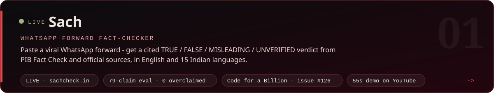
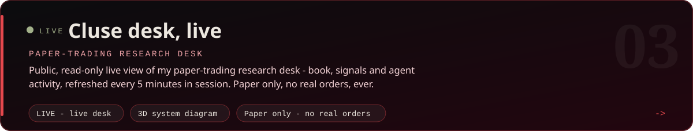
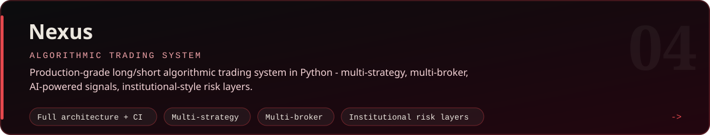

 

**[View my full portfolio site](https://pruthvig1998.github.io/pruthvig1998/)** - flagship projects, experience timeline and live demos in one page.

## 01 - About

## 02 - Flagship work

Live demos: [Sach](https://sachcheck.in) - [Sach impact page](https://sachcheck.in/impact) - [Sach 55s demo](https://youtu.be/ZFO4BZXokL4) - [QuantPilot Explorer](https://pruthvig1998.github.io/QuantPilot/explorer/) - [Cluse live desk](https://pruthvig1998.github.io/cluse-desk-live/) - [Cluse 3D diagram](https://pruthvig1998.github.io/cluse-desk-live/3d/)

## 03 - Core expertise

## 04 - GitHub activity

  

  

LIVE DATA - REGENERATED DAILY FROM MY GITHUB ACTIVITY

## 05 - Connect

The fastest way to evaluate my work is the live products above - Sach takes 10 seconds to try. For roles or collaboration, reach me on [LinkedIn](https://www.linkedin.com/in/pruthvi-g/).

