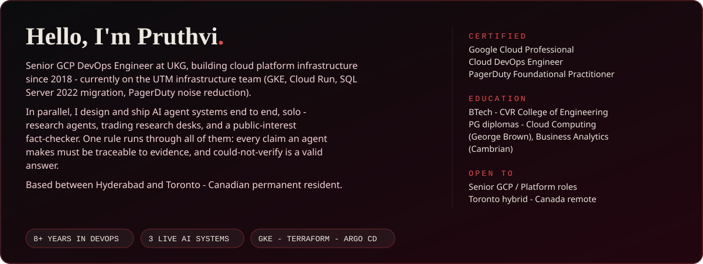
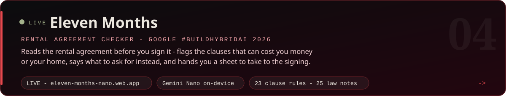
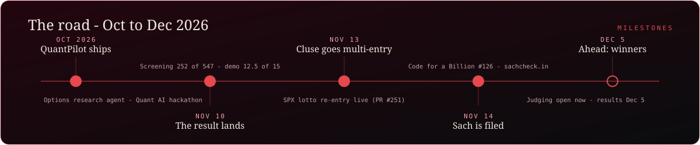

<picture><source media="(prefers-color-scheme: dark)" srcset="assets/banner.svg" /><source media="(prefers-color-scheme: light)" srcset="assets/banner-light.svg" /></picture>

<picture><source media="(prefers-color-scheme: dark)" srcset="assets/hero-panel.svg" /><source media="(prefers-color-scheme: light)" srcset="assets/hero-panel-light.svg" /></picture>

<a href="https://www.linkedin.com/in/pruthvi-g/" target="_blank" rel="noopener"><picture><source media="(prefers-color-scheme: dark)" srcset="assets/btn-linkedin.svg" /><source media="(prefers-color-scheme: light)" srcset="assets/btn-linkedin-light.svg" /></picture></a>
<a href="https://sachcheck.in" target="_blank" rel="noopener"><picture><source media="(prefers-color-scheme: dark)" srcset="assets/btn-sach.svg" /><source media="(prefers-color-scheme: light)" srcset="assets/btn-sach-light.svg" /></picture></a>
<a href="https://pruthvig1998.github.io/cluse-desk-live/" target="_blank" rel="noopener"><picture><source media="(prefers-color-scheme: dark)" srcset="assets/btn-cluse.svg" /><source media="(prefers-color-scheme: light)" srcset="assets/btn-cluse-light.svg" /></picture></a>
<a href="https://eleven-months-nano.web.app" target="_blank" rel="noopener"><picture><source media="(prefers-color-scheme: dark)" srcset="assets/btn-eleven.svg" /><source media="(prefers-color-scheme: light)" srcset="assets/btn-eleven-light.svg" /></picture></a>
<a href="https://pruthvig1998.github.io/pruthvig1998/" target="_blank" rel="noopener"><picture><source media="(prefers-color-scheme: dark)" srcset="assets/btn-portfolio.svg" /><source media="(prefers-color-scheme: light)" srcset="assets/btn-portfolio-light.svg" /></picture></a>

<picture><source media="(prefers-color-scheme: dark)" srcset="assets/whoami.svg" /><source media="(prefers-color-scheme: light)" srcset="assets/whoami-light.svg" /></picture>

## 01 - About

<picture><source media="(prefers-color-scheme: dark)" srcset="assets/about.svg" /><source media="(prefers-color-scheme: light)" srcset="assets/about-light.svg" /></picture>

**Now - November 2026**

| | |
|---|---|
| **Building** | AI agent systems that show their work - Sach is in the Code for a Billion judging window (winners Dec 5); Eleven Months, the rental agreement checker, shipped for #BuildHybridAI (deadline Nov 30) |
| **Maintaining** | Cluse, the live paper-trading research desk - it republishes itself daily |
| **At work** | UTM infrastructure at UKG - GKE, Cloud Run, SQL Server 2022 migration, PagerDuty noise reduction |
| **Open to** | Senior GCP / Platform roles - Toronto hybrid, Canada remote |

Credentials: **Google Cloud Professional Cloud DevOps Engineer** (Jan 2024) - verifiable in my <a href="https://www.credly.com/users/prudhvi-garlapati" target="_blank" rel="noopener">Credly badge wallet</a>; **PagerDuty Foundational Practitioner** (Feb 2025) - listed with issuer link on my <a href="https://www.linkedin.com/in/pruthvi-g/" target="_blank" rel="noopener">LinkedIn</a>.

Education: **BTech, Civil Engineering** - CVR College of Engineering, Hyderabad (2014-2018); **Postgraduate Diploma, Cloud Computing** - George Brown College (2022); **Postgraduate Diploma, Business Analytics** - Cambrian College (2021).

<picture><source media="(prefers-color-scheme: dark)" srcset="assets/divider.svg" /><source media="(prefers-color-scheme: light)" srcset="assets/divider-light.svg" /></picture>

## 02 - Flagship work

<a href="https://github.com/pruthvig1998/sach-check" target="_blank" rel="noopener"><picture><source media="(prefers-color-scheme: dark)" srcset="assets/card-sach.svg" /><source media="(prefers-color-scheme: light)" srcset="assets/card-sach-light.svg" /></picture></a>

 

<a href="https://github.com/pruthvig1998/QuantPilot" target="_blank" rel="noopener"><picture><source media="(prefers-color-scheme: dark)" srcset="assets/card-quantpilot.svg" /><source media="(prefers-color-scheme: light)" srcset="assets/card-quantpilot-light.svg" /></picture></a>

 

<a href="https://github.com/pruthvig1998/cluse-desk-live" target="_blank" rel="noopener"><picture><source media="(prefers-color-scheme: dark)" srcset="assets/card-cluse.svg" /><source media="(prefers-color-scheme: light)" srcset="assets/card-cluse-light.svg" /></picture></a>

 

<a href="https://github.com/pruthvig1998/eleven-months" target="_blank" rel="noopener"><picture><source media="(prefers-color-scheme: dark)" srcset="assets/card-eleven.svg" /><source media="(prefers-color-scheme: light)" srcset="assets/card-eleven-light.svg" /></picture></a>

 

Live demos: <a href="https://sachcheck.in" target="_blank" rel="noopener">Sach</a> - <a href="https://sachcheck.in/impact" target="_blank" rel="noopener">Sach impact page</a> - <a href="https://youtu.be/ZFO4BZXokL4" target="_blank" rel="noopener">Sach 55s demo</a> - <a href="https://pruthvig1998.github.io/QuantPilot/explorer/" target="_blank" rel="noopener">QuantPilot Explorer</a> - <a href="https://pruthvig1998.github.io/cluse-desk-live/" target="_blank" rel="noopener">Cluse live desk</a> - <a href="https://pruthvig1998.github.io/cluse-desk-live/3d/" target="_blank" rel="noopener">Cluse 3D diagram</a> - <a href="https://eleven-months-nano.web.app" target="_blank" rel="noopener">Eleven Months live app</a>

## 03 - Core expertise

<picture><source media="(prefers-color-scheme: dark)" srcset="assets/stack.svg" /><source media="(prefers-color-scheme: light)" srcset="assets/stack-light.svg" /></picture>

<picture><source media="(prefers-color-scheme: dark)" srcset="assets/divider.svg" /><source media="(prefers-color-scheme: light)" srcset="assets/divider-light.svg" /></picture>

## 04 - GitHub activity

<picture><source media="(prefers-color-scheme: dark)" srcset="assets/activity.svg" /><source media="(prefers-color-scheme: light)" srcset="assets/activity-light.svg" /></picture>

<picture><source media="(prefers-color-scheme: dark)" srcset="assets/city.svg" /><source media="(prefers-color-scheme: light)" srcset="assets/city-light.svg" /></picture>

<picture><source media="(prefers-color-scheme: dark)" srcset="assets/timeline.svg" /><source media="(prefers-color-scheme: light)" srcset="assets/timeline-light.svg" /></picture>

  

  

  

  

LIVE DATA - REGENERATED DAILY FROM MY GITHUB ACTIVITY

<picture><source media="(prefers-color-scheme: dark)" srcset="assets/divider.svg" /><source media="(prefers-color-scheme: light)" srcset="assets/divider-light.svg" /></picture>

## 05 - Writing

I write up what I build - the decisions, the numbers, and what the scores actually said.

- **The QuantPilot build story** - <a href="https://www.linkedin.com/feed/update/urn:li:activity:7526341625153822720/" target="_blank" rel="noopener">what a 66.5 out of 100 taught me</a> - the honest version, certificate attached, no win claimed.
- **The Sach launch post** - <a href="https://www.linkedin.com/in/pruthvi-g/recent-activity/all/" target="_blank" rel="noopener">LinkedIn</a> - the 55-second demo film and why a fact-checker must cite its verdicts.
- **The Sach story on dev.to** - <a href="https://dev.to/pruthvig1998/every-family-whatsapp-group-in-india-has-the-same-problem-1jf6" target="_blank" rel="noopener">Every family WhatsApp group in India has the same problem</a> - why a fact-checker must cite its verdicts.
- **The QuantPilot story on dev.to** - <a href="https://dev.to/pruthvig1998/proud-to-share-quantpilot-my-solo-build-for-the-open-agent-hackathon-2026-1p22" target="_blank" rel="noopener">Proud to share QuantPilot, my solo build for the Open Agent Hackathon 2026</a>.
- Full CV and experience history - <a href="https://www.linkedin.com/in/pruthvi-g/" target="_blank" rel="noopener">LinkedIn</a>, kept current there.

## 06 - Latest activity

<!--START_SECTION:activity-->
1. 🎉 Merged PR <a href="https://github.com/pruthvig1998/sach-check/pull/3" target="_blank" rel="noopener">#3</a> in <a href="https://github.com/pruthvig1998/sach-check" target="_blank" rel="noopener">pruthvig1998/sach-check</a>
2. 💪 Opened PR <a href="https://github.com/pruthvig1998/sach-check/pull/3" target="_blank" rel="noopener">#3</a> in <a href="https://github.com/pruthvig1998/sach-check" target="_blank" rel="noopener">pruthvig1998/sach-check</a>
- Nov 14, 2026 - Sach filed in Code for a Billion (issue #126), launch post published
<!--END_SECTION:activity-->

This section rewrites itself daily from my public GitHub activity.

## 07 - Connect

The fastest way to evaluate my work is the live products above - Sach takes 10 seconds to try. For roles or collaboration, reach me on <a href="https://www.linkedin.com/in/pruthvi-g/" target="_blank" rel="noopener">LinkedIn</a>.

### Guestbook

Visiting? <a href="https://github.com/pruthvig1998/pruthvig1998/issues/new?title=Guestbook%3A+signing+in" target="_blank" rel="noopener">Open a Guestbook issue</a> and your avatar signs below automatically.

<!--START_SECTION:guestbook-->
*Be the first to sign.*
<!--END_SECTION:guestbook-->

<picture><source media="(prefers-color-scheme: dark)" srcset="assets/footer.svg" /><source media="(prefers-color-scheme: light)" srcset="assets/footer-light.svg" /></picture>
