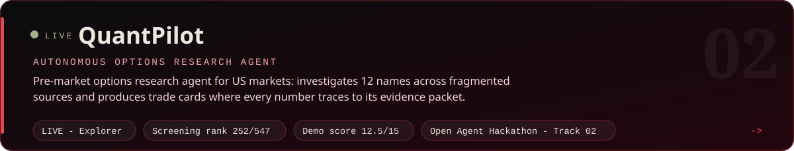
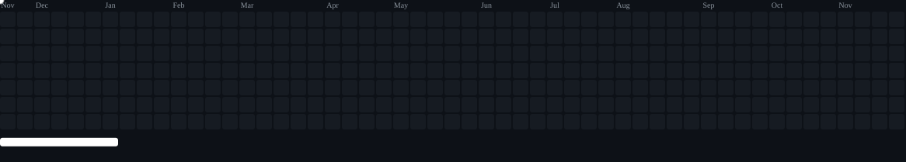
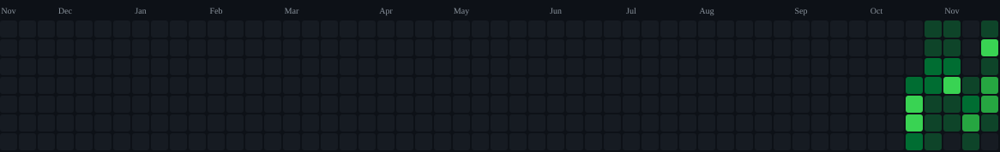

<picture><source media="(prefers-color-scheme: dark)" srcset="assets/banner.svg" /><source media="(prefers-color-scheme: light)" srcset="assets/banner-light.svg" /></picture>

**Senior GCP DevOps Engineer at UKG** - GKE · Terraform · Argo CD · Cloud Run. I build AI agents that have to show their work: Sach, QuantPilot, Cluse - built solo, live in production.

**[View my full portfolio site](https://pruthvig1998.github.io/pruthvig1998/)** - flagship projects, experience timeline and live demos in one page.

<picture><source media="(prefers-color-scheme: dark)" srcset="assets/whoami.svg" /><source media="(prefers-color-scheme: light)" srcset="assets/whoami-light.svg" /></picture>

## 01 - About

<picture><source media="(prefers-color-scheme: dark)" srcset="assets/about.svg" /><source media="(prefers-color-scheme: light)" srcset="assets/about-light.svg" /></picture>

**Now - November 2026**

| | |
|---|---|
| **Building** | AI agent systems that show their work - Sach is in the Code for a Billion judging window (winners Dec 5) |
| **Maintaining** | Cluse, the live paper-trading research desk - it republishes itself daily |
| **At work** | UTM infrastructure at UKG - GKE, Cloud Run, SQL Server 2022 migration, PagerDuty noise reduction |
| **Open to** | Senior GCP / Platform roles - Toronto hybrid, Canada remote |

Credentials: **Google Cloud Professional Cloud DevOps Engineer** (Jan 2024) - verifiable in my [Credly badge wallet](https://www.credly.com/users/prudhvi-garlapati); **PagerDuty Foundational Practitioner** (Feb 2025) - listed with issuer link on my [LinkedIn](https://www.linkedin.com/in/pruthvi-g/).

Education: **BTech, Civil Engineering** - CVR College of Engineering, Hyderabad (2014-2018); **Postgraduate Diploma, Cloud Computing** - George Brown College (2022); **Postgraduate Diploma, Business Analytics** - Cambrian College (2021).

<picture><source media="(prefers-color-scheme: dark)" srcset="assets/divider.svg" /><source media="(prefers-color-scheme: light)" srcset="assets/divider-light.svg" /></picture>

## 02 - Flagship work

<a href="https://github.com/pruthvig1998/sach-check"><picture><source media="(prefers-color-scheme: dark)" srcset="assets/card-sach.svg" /><source media="(prefers-color-scheme: light)" srcset="assets/card-sach-light.svg" /></picture></a>

 

<a href="https://github.com/pruthvig1998/QuantPilot"><picture><source media="(prefers-color-scheme: dark)" srcset="assets/card-quantpilot.svg" /><source media="(prefers-color-scheme: light)" srcset="assets/card-quantpilot-light.svg" /></picture></a>

 

<a href="https://github.com/pruthvig1998/cluse-desk-live"><picture><source media="(prefers-color-scheme: dark)" srcset="assets/card-cluse.svg" /><source media="(prefers-color-scheme: light)" srcset="assets/card-cluse-light.svg" /></picture></a>

 

Live demos: [Sach](https://sachcheck.in) - [Sach impact page](https://sachcheck.in/impact) - [Sach 55s demo](https://youtu.be/ZFO4BZXokL4) - [QuantPilot Explorer](https://pruthvig1998.github.io/QuantPilot/explorer/) - [Cluse live desk](https://pruthvig1998.github.io/cluse-desk-live/) - [Cluse 3D diagram](https://pruthvig1998.github.io/cluse-desk-live/3d/)

## 03 - Core expertise

<picture><source media="(prefers-color-scheme: dark)" srcset="assets/stack.svg" /><source media="(prefers-color-scheme: light)" srcset="assets/stack-light.svg" /></picture>

<picture><source media="(prefers-color-scheme: dark)" srcset="assets/divider.svg" /><source media="(prefers-color-scheme: light)" srcset="assets/divider-light.svg" /></picture>

## 04 - GitHub activity

<picture><source media="(prefers-color-scheme: dark)" srcset="assets/activity.svg" /><source media="(prefers-color-scheme: light)" srcset="assets/activity-light.svg" /></picture>

<picture><source media="(prefers-color-scheme: dark)" srcset="assets/city.svg" /><source media="(prefers-color-scheme: light)" srcset="assets/city-light.svg" /></picture>

<picture><source media="(prefers-color-scheme: dark)" srcset="assets/timeline.svg" /><source media="(prefers-color-scheme: light)" srcset="assets/timeline-light.svg" /></picture>

  

  

  

  

LIVE DATA - REGENERATED DAILY FROM MY GITHUB ACTIVITY

<picture><source media="(prefers-color-scheme: dark)" srcset="assets/divider.svg" /><source media="(prefers-color-scheme: light)" srcset="assets/divider-light.svg" /></picture>

## 05 - Writing

I write up what I build - the decisions, the numbers, and what the scores actually said.

- **The QuantPilot build story** - [what a 66.5 out of 100 taught me](https://www.linkedin.com/feed/update/urn:li:activity:7526341625153822720/) - the honest version, certificate attached, no win claimed.
- **The Sach launch post** - [LinkedIn](https://www.linkedin.com/in/pruthvi-g/recent-activity/all/) - the 55-second demo film and why a fact-checker must cite its verdicts.
- **The Sach story on dev.to** - [Every family WhatsApp group in India has the same problem](https://dev.to/pruthvig1998/every-family-whatsapp-group-in-india-has-the-same-problem-1jf6) - why a fact-checker must cite its verdicts.
- **The QuantPilot story on dev.to** - [Proud to share QuantPilot, my solo build for the Open Agent Hackathon 2026](https://dev.to/pruthvig1998/proud-to-share-quantpilot-my-solo-build-for-the-open-agent-hackathon-2026-1p22).
- Full CV and experience history - [LinkedIn](https://www.linkedin.com/in/pruthvi-g/), kept current there.

## 06 - Latest activity

<!--START_SECTION:activity-->
1. 🎉 Merged PR [#3](https://github.com/pruthvig1998/sach-check/pull/3) in [pruthvig1998/sach-check](https://github.com/pruthvig1998/sach-check)
2. 💪 Opened PR [#3](https://github.com/pruthvig1998/sach-check/pull/3) in [pruthvig1998/sach-check](https://github.com/pruthvig1998/sach-check)
- Nov 14, 2026 - Sach filed in Code for a Billion (issue #126), launch post published
<!--END_SECTION:activity-->

This section rewrites itself daily from my public GitHub activity.

## 07 - Connect

The fastest way to evaluate my work is the live products above - Sach takes 10 seconds to try. For roles or collaboration, reach me on [LinkedIn](https://www.linkedin.com/in/pruthvi-g/).

### Guestbook

Visiting? [Open a Guestbook issue](https://github.com/pruthvig1998/pruthvig1998/issues/new?title=Guestbook%3A+signing+in) and your avatar signs below automatically.

<!--START_SECTION:guestbook-->
*Be the first to sign.*
<!--END_SECTION:guestbook-->

<picture><source media="(prefers-color-scheme: dark)" srcset="assets/footer.svg" /><source media="(prefers-color-scheme: light)" srcset="assets/footer-light.svg" /></picture>
